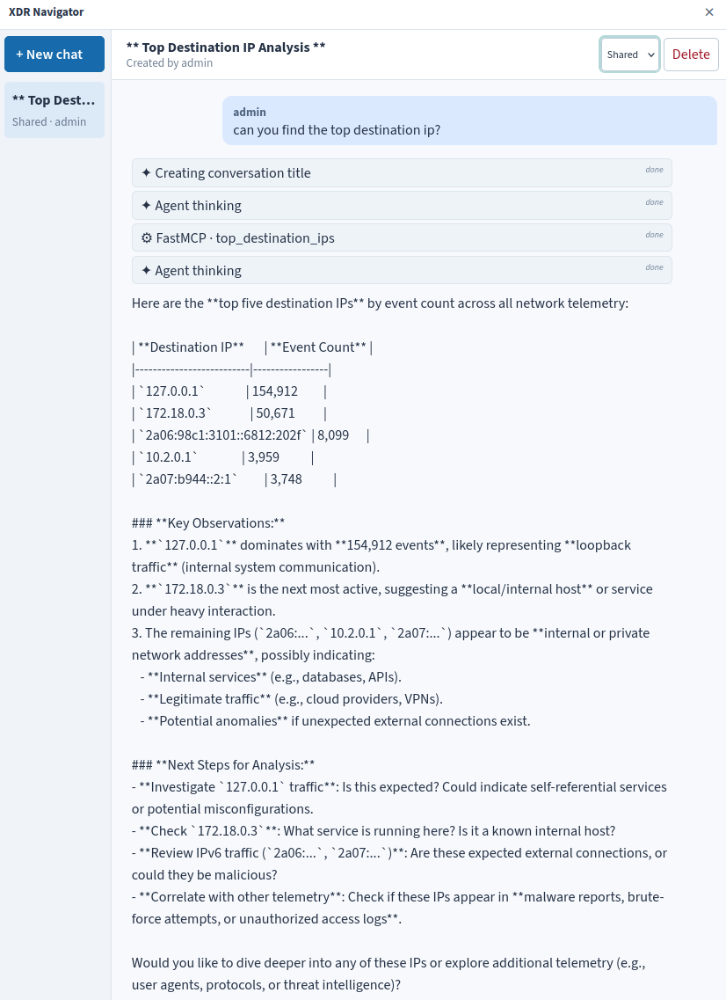

# XDR FastMCP

A Dockerized [FastMCP](https://gofastmcp.com/) server that automatically exposes
Python functions from `tools/` over Streamable HTTP.

<div align="center">
  
</div>

## Deploy locally

Install Docker Engine on Linux with Docker Compose, then run from this repository:

```sh
docker compose -f docker-compose.xdr-fastmcp.yml up -d --build
docker compose -f docker-compose.xdr-fastmcp.yml ps
curl --fail http://127.0.0.1:8000/health
```

Connect an MCP client using Streamable HTTP at `http://127.0.0.1:8000/mcp`.
`/health` reports server availability and the number of loaded tools.

```sh
# Inspect logs / stop and remove the local deployment
docker compose -f docker-compose.xdr-fastmcp.yml logs -f
docker compose -f docker-compose.xdr-fastmcp.yml down
```

Compose mounts local `tools/` at `/app/tools` read-only and runs as a non-root
user. Host networking reaches local OpenSearch; MCP listens on all interfaces.
There is no MCP authentication configured; add authentication and TLS before
exposing it beyond your local machine.

For a standalone image build: `docker build -t xdr-fastmcp:local .`.

## Container image

[GitHub Actions](.github/workflows/container.yml) publishes Linux amd64 images
to `ghcr.io/kplrm/xdr-fastmcp` on pushes to `main` or manual runs. Main builds
update `latest`; every build also has a `sha-<full-commit>` tag.
Publishing uses `GITHUB_TOKEN`; no additional repository secret is needed.

After the first run, [set the package visibility to public](https://docs.github.com/en/packages/learn-github-packages/configuring-a-packages-access-control-and-visibility)
for pulls without credentials, including the Kubernetes deployment below.

```sh
docker pull ghcr.io/kplrm/xdr-fastmcp:latest
```

## Deploy on Kubernetes (one pod)

Run from this repository on a host with cluster access. This assumes namespace `opensearch`.

### Create the OpenSearch user and role

Create only read role `telemetry_read`, scoped by [telemetry-read-role.json](deploy/telemetry-read-role.json) to read `xdr-agent-telemetry`.

```bash
OS_URL='https://OPENSEARCH_HOST:PORT'
OS_CA='/path/to/opensearch-ca.pem'
curl --fail-with-body --cacert "$OS_CA" --user admin \
  --request PUT "$OS_URL/_plugins/_security/api/roles/xdr_fastmcp" \
  --header 'Content-Type: application/json' \
  --data-binary @deploy/xdr-fastmcp-role.json
```

Create the user `xdr-fastmcp`.

```bash
read -rsp 'FastMCP password (same as private .env): ' FASTMCP_PASSWORD
printf '\n'
jq -n --arg password "$FASTMCP_PASSWORD" \
  '{password: $password, opendistro_security_roles: ["telemetry_read"]}' |
curl --fail-with-body --cacert "$OS_CA" --user admin \
  --request PUT "$OS_URL/_plugins/_security/api/internalusers/xdr-fastmcp" \
  --header 'Content-Type: application/json' --data-binary @-
unset FASTMCP_PASSWORD
```

### Deploy and verify

The image tag supports AMD64 and ARM64; Kubernetes selects the matching image.

Edit values in `.env.example` and save your changes to `.env.fastmcp`.

```bash
kubectl -n opensearch create secret generic xdr-fastmcp-env \
  --from-env-file=.env.fastmcp --dry-run=client -o yaml | kubectl apply -f -
kubectl -n opensearch apply -f kubernetes.yaml
kubectl -n opensearch rollout status deployment/xdr-fastmcp --timeout=120s
```

Test connectivity to OpenSearch from the deployed FastMCP pod.

```bash
kubectl -n opensearch exec deployment/xdr-fastmcp -- python -c \
  'from tools.top_remote_ips import top_remote_ips; top_remote_ips(); print("OpenSearch access OK")'
```

Connect your MCP client to `http://xdr-fastmcp.opensearch.svc.cluster.local:8000/mcp`.

## Tool discovery

Tools stay outside the image. Compose mounts local `tools/`; each new Kubernetes
pod downloads GitHub `main` and loads its tools at startup. Push tool changes,
then run:

```sh
kubectl -n opensearch rollout restart deployment/xdr-fastmcp
```

Dependency changes in `requirements.txt` require publishing a new image first.

## Contributing

See [CONTRIBUTING.md](CONTRIBUTING.md) for development, validation, and reporting guidelines.

## License

Copyright (C) 2026 Diego A. Guillen-Rosaperez

XDR FastMCP is free software under [GNU AGPLv3 only](LICENSE) (`AGPL-3.0`), which requires sharing source code when distributed or when modified versions serve remote users.

- **Usage:** use, modify, redistribute, and sell it, including cloud hosting, while following the license.
- **Distribution:** share the complete source code with recipients, including your changes and build files, using a method permitted by AGPLv3.
- **Network use (§13):** if you run a modified version, prominently offer every remote user free access to its complete source code, even without distribution.
- **Copyleft:** keep covered modified versions under AGPLv3, preserve notices, and identify your changes. Dependencies retain their own licenses.
- **Warranty:** provided without warranty; liability is limited as specified in the license.

> Sharing source code with the required users is mandatory.

- **Custom tools:** adding tools can create an AGPL-covered combined program. When distributing that program or serving a modified version remotely, include the tools’ source in the required source offer. Independent works, or tools used only locally without distribution, may remain private. Excluding tools from the image build does not create an exemption.
